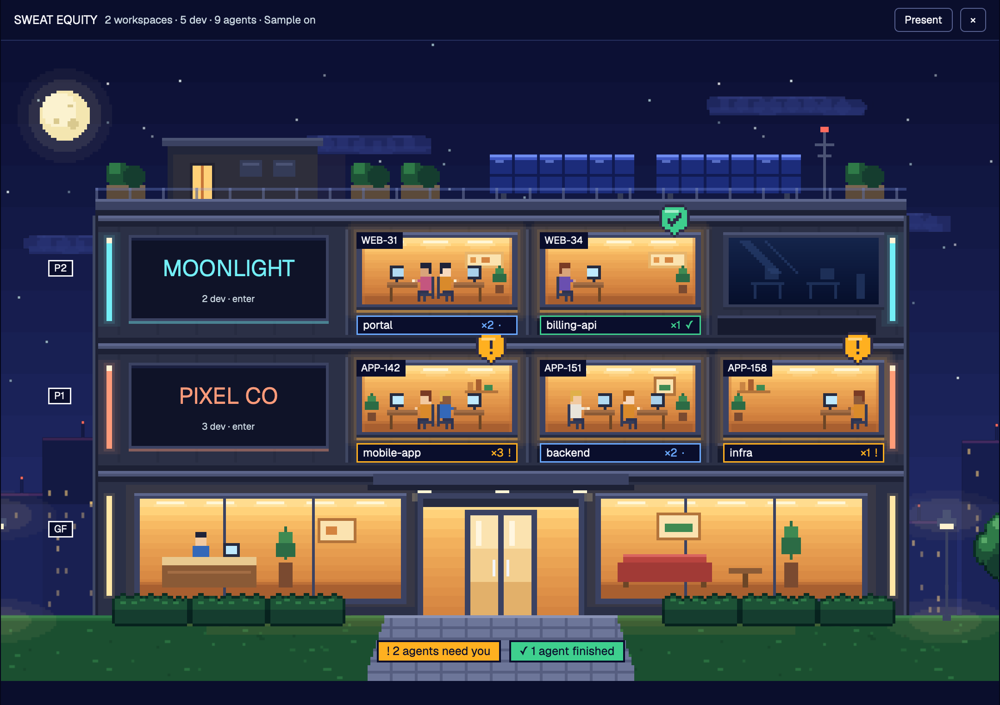

# Sweat Equity

Un layout para [Herdr](https://herdr.dev) que muestra tu trabajo como una torre de oficinas en pixel art, de noche. Cada piso es una empresa o workspace, cada ventana es un desarrollo con sus agentes adentro, y cada cuarto de un piso es un equipo trabajando una misma historia.



Read in English: [README.md](README.md)

Los textos del edificio salen en inglés. Para verlos en español, pon `{ "lang": "es" }` en `~/.config/herdr-app/sweat-equity.json`. Esta guía usa los nombres en español.

## La idea en un minuto

| En el edificio | Es | Sale de |
|---|---|---|
| Un piso | una empresa o workspace | una carpeta que tú eliges |
| Una ventana | un desarrollo | un space de Herdr cuyas terminales trabajan dentro de esa carpeta |
| Un cuarto dentro del piso | un equipo en una historia | la clave de la historia en la rama de git (`feature/ABC-12-login` da `ABC-12`) |
| Una persona | un agente, o un ayudante que ese agente lanzó | los agentes de Herdr y sus terminales |

Una ventana encendida tiene agentes adentro. El ámbar siempre significa «un agente te está esperando»; el verde, «un agente terminó y todavía no lo has visto».

## Instalación

Pídele al agente de tu Herdr que agregue `herdr.dev/layouts/jcruzdz/sweat-equity`, o hazlo a mano:

```sh
cd sweat-equity                                   # este repositorio
cp layouts/sweat-equity.json layouts/sweat-equity.png ~/.config/herdr-app/layouts/
cp -R mods/sweat-equity ~/.config/herdr-app/mods/
herdr-app check ~/.config/herdr-app/mods/sweat-equity
herdr-app do layout.switch --name sweat-equity
```

Después agrega las dos teclas de `keys.json` a tu `~/.config/herdr-app/keys.json`. Con `ctrl-shift-l` regresas a tu layout anterior cuando quieras, y borrando esos archivos se quita este.

## Primeros pasos

1. Abre el edificio con `cmd-shift-e` (`ctrl-shift-e` en Linux y Windows), o con un clic en la línea `▟ SE` al pie de la barra lateral.
2. En el piso de arriba, haz clic en `+ workspace` y elige la carpeta donde están los repositorios de esa empresa. El piso toma el nombre de la carpeta y un color.
3. Cada space que trabaje dentro de esa carpeta ya es una ventana de ese piso. Repite por cada empresa.

## El día a día

**Empezar algo nuevo.** Clic en `+ nuevo` en el letrero del piso (o en su primera ventana vacía). Eliges dónde (la carpeta del workspace o uno de los repositorios que encontró ahí), con qué agente y, si quieres, su primer mensaje. `Iniciar` lo abre y te lleva ahí. Si ya hay un space en esa carpeta, se le suma una pestaña en lugar de abrir otro space.

**Ver quién te necesita.** Una baliza ámbar que sube y baja sobre la ventana, y `! N agentes te esperan` en el camino de entrada: un clic te lleva al primero. Una bandera verde y `✓ N agentes terminaron` hacen lo mismo con los que ya acabaron; la bandera se quita cuando ves a ese agente.

**Ver quién está trabajando.** La ventana respira y la gente adentro teclea; su etiqueta muestra puntos que se mueven.

**Ir a un desarrollo.** Clic en la etiqueta bajo su ventana.

**Mover un desarrollo a otro piso.** Clic derecho en su etiqueta y `Mover a …`. `Volver a automático` lo deshace. Un desarrollo está siempre en un solo piso: donde tú lo moviste; si no, donde trabaja la mayoría de sus terminales; si no, donde arrancó.

**Los desarrollos sin piso** esperan afuera, junto a la banca. Con un clic los mandas a un piso o les das uno propio.

**Editar un piso.** El lápiz de su letrero: renombrarlo, cambiarle el color o la carpeta, o quitarlo.

**Entrar a un piso.** Clic en su letrero. Cada cuarto es un equipo: los agentes cuya rama trae la misma historia, sentados con los ayudantes que lanzaron. Los que trabajan sin historia comparten un cuarto; los que están libres descansan en la sala. La etiqueta de cada compañero dice quién es y en qué anda, y uno a la vez lo dice completo. La lista del equipo lo repite en texto, con tiempo y tokens para los ayudantes. Un clic en cualquiera te lleva a su terminal. `← Edificio` regresa.

**Ocultar un piso.** El ojo del letrero lo oculta: el piso sale del edificio y sus ventanas, alertas y conteos se van con él (también de la línea del costado). Nada en pantalla dice que hay algo oculto; solo la luna reacciona, con cursor y aviso al pasar sobre ella. Mientras haya un piso oculto, la luna es un botón: un clic y los pisos ocultos regresan como pisos vacíos y atenuados, marcados `Oculto`; el ojo de uno lo devuelve para siempre y otro clic en la luna vuelve a ocultar los demás. Eso no se guarda: al reiniciar, los pisos ocultos siguen ocultos.

**Presentar.** `Presentar` quita los controles de edición (ojo, lápiz, `+ nuevo`), el piso disponible y a quien espera afuera, para que solo quede el edificio. `Salir de presentar` los regresa. Los pisos ocultos siguen ocultos con o sin presentar.

**¿Solo quieres verlo?** `Demo` pone un edificio inventado para ver todos los estados sin ningún nombre tuyo en pantalla.

## Pizarras con tus historias (opcional, Jira Cloud)

Cada cuarto de equipo tiene una pizarra. Con Jira conectado muestra el estado y el título de la historia, y una tarjeta por subtarea en tres columnas: por hacer, en curso, hecho. Un clic en la pizarra abre la historia en tu navegador.

1. Crea un token de API en id.atlassian.com (Seguridad, Tokens de API).
2. Guárdalo en el llavero de macOS. El comando te pide el token y no se escribe en ningún archivo:

   ```sh
   security add-generic-password -s herdr-jira -a tu@empresa.com -w
   ```

3. Dile al edificio dónde está tu Jira, en `~/.config/herdr-app/sweat-equity.json`:

   ```json
   { "lang": "es", "jira": "https://tuempresa.atlassian.net" }
   ```

4. Cierra y vuelve a abrir el edificio. El pie dice qué pasó: `Jira: 2/3 US`, `Jira conectado · ninguna rama trae clave de US todavía`, o el error.

La pizarra necesita una rama que traiga la clave de la historia, como `feature/ABC-12-login`. Los agentes en `main` no tienen historia, así que su cuarto tiene la pizarra vacía.

## Ajustes

Todos opcionales, en `~/.config/herdr-app/sweat-equity.json`. El archivo se lee al abrir el edificio.

| Clave | Qué hace |
|---|---|
| `lang` | `"en"` (por defecto) o `"es"` |
| `jira` | la dirección de tu Jira Cloud; enciende las pizarras |
| `keychain` | nombre de la entrada del llavero con el token (por defecto `herdr-jira`) |
| `jiraBoards` | `{ "PROJ": 12 }`: qué tablero usa un proyecto cuando tiene varios (por defecto, su primer tablero kanban). Las columnas y qué estado va en cada una siempre se leen de ese tablero, nunca se fijan aquí |
| `jiraBlocked` | regex de los nombres de estado que significan detenido (por defecto `deten\|bloque\|blocked\|hold\|impedi\|paus\|espera`): se quedan en su columna, en rojo |
| `workspaces` | una lista inicial, `[{ "name", "root", "color" }]`, que solo se usa hasta que agregas o cambias un piso en el edificio |
| `demo` | `true` muestra siempre el edificio de ejemplo |
| `frame` | `[ancho, alto]` dibuja el edificio en un recuadro de ese tamaño, para capturas |

Tus pisos, lo que está oculto y lo que moviste a mano lo guarda Herdr con el resto de su estado.

## Otras computadoras

Un space en otra computadora cae en el mismo piso cuando su carpeta está en el mismo lugar bajo la carpeta de usuario de esa máquina (`~/trabajo/acme` aquí y allá). Su ventana dice `nombre@máquina`. Empezar algo nuevo desde el edificio solo funciona en esta computadora.

## Qué lee y qué ejecuta

- Los datos en vivo de Herdr: spaces, terminales, agentes, sus carpetas, ramas y títulos.
- El archivo de ajustes de arriba, y su propio estado a través de Herdr.
- `find`, a tres carpetas de profundidad dentro de la carpeta de un workspace, para listar sus repositorios cuando haces clic en `+ nuevo`.
- `hc read`, las últimas 40 líneas de la pantalla de cada agente del piso en el que estás, cada 6 segundos, para encontrar los ayudantes que lista ahí.
- Con Jira encendido: `security` para leer el token del llavero (se queda solo en memoria), y peticiones a tu dirección de Jira por las historias en pantalla y el tablero de su proyecto, cada minuto. Cuando una historia o subtarea cambia de estado, la línea de la barra lateral manda una notificación (si se detuvo, como advertencia). Nada más sale de tu computadora.
- Escribe un solo archivo, `mods/sweat-equity/.debug.json`: una foto de lo que muestra el edificio, para diagnosticar.

## Si algo se ve mal

- **El edificio muestra un error o queda vacío.** Corre `herdr-app status`: lista los errores de los mods. `herdr-app check ~/.config/herdr-app/mods/sweat-equity` carga el mod y da el error exacto.
- **Un desarrollo quedó en el piso equivocado.** Clic derecho en su etiqueta y muévelo. `.debug.json` lista las carpetas en las que trabaja cada desarrollo, que es lo que usa la regla automática.
- **No hay pizarra.** Lee la nota del pie y revisa que la rama traiga la clave de la historia.
- **Quieres tu ventana de antes.** `ctrl-shift-l` cambia de layout. `ctrl-alt-shift-escape`, de Herdr, siempre regresa a su layout por defecto.

## El arte

Todo lo dibuja el código de `art/` (Python; los sprites necesitan Pillow); nada está calcado ni descargado. Cambia ahí un color o un mueble y vuelve a generar:

```sh
python3 art/export.py mods/sweat-equity
```

`RECIPE.md` es la especificación completa del layout: qué muestra cada región, cómo se comporta y qué tiene que salir bien en una construcción desde cero.

## Licencia

Sweat Equity es de código disponible bajo la [Sustainable Use License 1.0](LICENSE) (SPDX: `SUL-1.0`), no de código abierto.

Puedes usarlo y modificarlo para ti, con fines no comerciales o dentro de tu propia empresa. Solo puedes pasarlo a otras personas de forma gratuita, sin fines comerciales y con la licencia incluida. Venderlo, o incluirlo en un producto o servicio de pago, requiere permiso escrito del autor: para pedirlo, abre un issue en https://github.com/jcruzdz/sweat-equity/issues.

El código, el arte pixelado y los sprites son una sola obra bajo los mismos términos. La galería de Herdr puede listar este layout y mostrar su vista previa y su receta.
