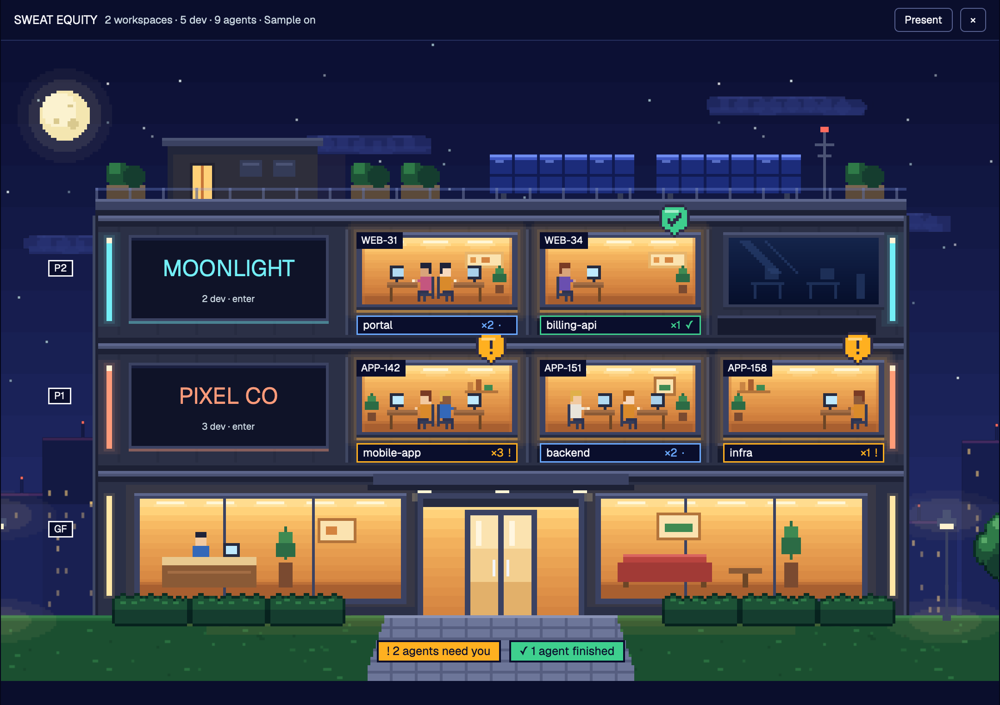

# Sweat Equity

A layout for [Herdr](https://herdr.dev) that shows your work as a pixel-art office tower at night. Every floor is a company or workspace, every window is a development with its agents inside, and every room on a floor is a squad working one ticket.



Leer en español: [README.es.md](README.es.md)

## The idea in one minute

| In the tower | Is | Comes from |
|---|---|---|
| A floor | a company or workspace | a folder you pick |
| A window | a development | a Herdr space whose terminals work inside that folder |
| A room inside a floor | a squad on one ticket | the ticket key in the git branch (`feature/ABC-12-login` gives `ABC-12`) |
| A person | an agent, or a helper an agent started | Herdr's agents and their terminals |

A lit window has agents inside. Amber always means "an agent is waiting for you", green means "an agent finished and you have not looked yet".

## Install

Ask the agent in your Herdr to add `herdr.dev/layouts/jcruzdz/sweat-equity`, or do it by hand:

```sh
cd sweat-equity                                   # this repository
cp layouts/sweat-equity.json layouts/sweat-equity.png ~/.config/herdr-app/layouts/
cp -R mods/sweat-equity ~/.config/herdr-app/mods/
herdr-app check ~/.config/herdr-app/mods/sweat-equity
herdr-app do layout.switch --name sweat-equity
```

Then add the two keys in `keys.json` to your own `~/.config/herdr-app/keys.json`. `ctrl-shift-l` switches back to your previous layout at any time, and deleting those files removes this one.

## First steps

1. Open the tower with `cmd-shift-e` (`ctrl-shift-e` on Linux and Windows), or click the `▟ SE` line at the bottom of the sidebar.
2. On the top floor, click `+ workspace` and pick the folder that holds that company's repositories. The floor takes the folder's name and a color.
3. Every space working inside that folder is now a window on that floor. Repeat for each company.

## Day to day

**Start something new.** Click `+ new` on a floor's sign (or on its first empty window). Pick where (the workspace folder or one of the repositories found in it), with which agent, and optionally its first message. `Start` opens it and takes you there. If a space already has that folder, it gets a new tab instead of a second space.

**See who needs you.** A bobbing amber beacon above a window, and `! N agents need you` on the path: click it to jump to the first one. A green flag and `✓ N agents finished` work the same way for agents that are done; the flag goes away once you look at that agent.

**See who is working.** A working window breathes and the people inside type; its chip shows moving dots.

**Go to a development.** Click the chip under its window.

**Move a development to another floor.** Right-click its chip and choose `Move to …`. `Back to automatic` undoes it. A development is always on one floor only: where you moved it, else where most of its terminals are working, else where it started.

**Developments with no floor** wait outside by the bench. Click one to send it to a floor or give it a floor of its own.

**Edit a floor.** The pen on its sign: rename it, change its color or folder, or remove it.

**Step inside a floor.** Click its sign. Each room is a squad: the agents whose branch carries the same ticket, sitting with the helpers they started. Agents working without a ticket share one room; idle agents rest in the lounge. Each coworker's label shows who they are and what they are on, and one of them at a time says it in full. The team list repeats it as text, with time and tokens for helpers. Click anyone to jump to their terminal. `← Tower` goes back.

**Hide a floor.** The eye on a floor's sign hides it: the floor leaves the tower, and its windows, alerts and counts leave with it (the sidebar line too). Nothing on screen says that something is hidden; only the moon reacts, with a pointer and a tooltip when you hover it. While a floor is hidden, the moon is a button: click it and the hidden floors come back as empty, muted floors marked `Hidden`; the eye on one brings it back for good, and another click on the moon hides the rest again. Showing them is not saved: after a restart, hidden floors are hidden.

**Present.** `Present` removes the editing controls (eye, pen, `+ new`), the spare floor and whoever waits outside, so only the tower is left. `Stop presenting` brings them back. Hidden floors stay hidden either way.

**Just looking?** `Sample` swaps in a made-up tower so you can see every state without any of your own names on screen.

## Ticket whiteboards (optional, Jira Cloud)

Each squad room has a whiteboard. Connect Jira and it shows the ticket's status and title, and one card per subtask in three columns: to do, in progress, done. Clicking the whiteboard opens the ticket in your browser.

1. Create an API token at id.atlassian.com (Security, API tokens).
2. Store it in the macOS keychain. The command asks for the token and nothing is written to a file:

   ```sh
   security add-generic-password -s herdr-jira -a you@company.com -w
   ```

3. Tell the tower where your Jira is, in `~/.config/herdr-app/sweat-equity.json`:

   ```json
   { "jira": "https://yourcompany.atlassian.net" }
   ```

4. Close and reopen the tower. The footer says what happened: `Jira: 2/3 tickets`, `Jira connected · no branch carries a ticket key yet`, or the error.

A whiteboard needs a branch that carries the ticket key, such as `feature/ABC-12-login`. Agents on `main` have no ticket, so their room has an empty board.

## Settings

All optional, in `~/.config/herdr-app/sweat-equity.json`. The file is read when the tower opens.

| Key | What it does |
|---|---|
| `lang` | `"en"` (default) or `"es"` |
| `jira` | your Jira Cloud address; turns the whiteboards on |
| `keychain` | name of the keychain entry with the token (default `herdr-jira`) |
| `workspaces` | a starting list, `[{ "name", "root", "color" }]`, used only until you add or change a floor in the tower |
| `demo` | `true` always shows the sample tower |
| `frame` | `[width, height]` draws the tower in a box of that size, for screenshots |

Your floors, what is hidden and what you moved by hand are kept by Herdr with the rest of its state.

## Other machines

A space on another machine joins the same floor when its folder sits at the same place under that machine's home folder (`~/work/acme` here and there). Its window reads `name@machine`. Starting something new from the tower works on this computer only.

## What it reads and runs

- Herdr's own live data: spaces, terminals, agents, their folders, branches and titles.
- The settings file above, and its own state through Herdr.
- `find`, three folders deep in a workspace folder, to list its repositories when you click `+ new`.
- `hc read`, the last 40 lines of each agent's screen on the floor you are inside, every 6 seconds, to find the helpers it lists there.
- With Jira on: `security` to read the token from the keychain (kept in memory only), and requests to your Jira address for the tickets on screen, every two minutes. Nothing else leaves your computer.
- It writes one file, `mods/sweat-equity/.debug.json`: a snapshot of what the tower shows, for troubleshooting.

## If something looks wrong

- **The tower shows an error or stays empty.** Run `herdr-app status`: it lists errors from mods. `herdr-app check ~/.config/herdr-app/mods/sweat-equity` loads the mod and prints the exact error.
- **A development is on the wrong floor.** Right-click its chip and move it. `.debug.json` lists the folders each development works in, which is what the automatic rule uses.
- **No whiteboard.** Read the footer note, and check that the branch carries a ticket key.
- **You want your old window back.** `ctrl-shift-l` switches layouts. Herdr's `ctrl-alt-shift-escape` always returns to its default layout.

## The art

Everything is drawn by the code in `art/` (Python; the sprites need Pillow), nothing is traced or downloaded. Change a color or a piece of furniture there and rebuild:

```sh
python3 art/export.py mods/sweat-equity
```

`RECIPE.md` is the full brief of the layout: what every region shows, how it behaves, and what a fresh build must get right.

## License

Sweat Equity is source-available under the [Sustainable Use License 1.0](LICENSE) (SPDX: `SUL-1.0`), not open source.

You can use it and change it for yourself, for non-commercial purposes, or inside your own company. You can pass it on only for free, for non-commercial purposes, and with the license attached. Selling it, or including it in a paid product or service, needs the author's written permission: open an issue at https://github.com/jcruzdz/sweat-equity/issues to ask.

The code, the pixel art and the sprites are one work under the same terms. The Herdr gallery may list this layout and show its preview and recipe.
