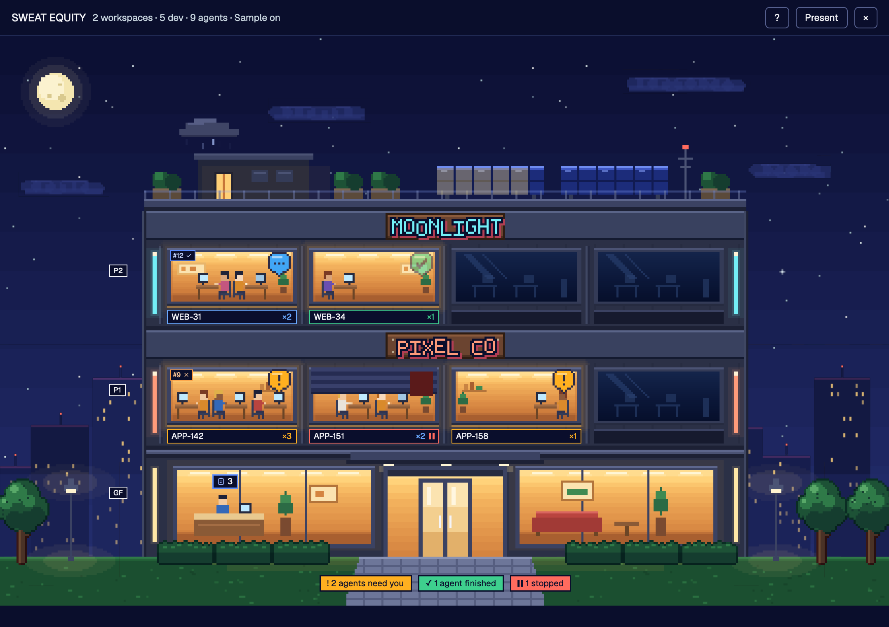

# Sweat Equity

Your workspaces as a pixel-art office tower at night. Each floor is a company or workspace (a folder you pick), each window is a development (a Herdr space) and it is lit when agents are inside. Step into a floor and it becomes a small office seen from above, where every room is a squad: the agents whose git branch carries the same ticket key, sitting with the helpers they started, each with a job and a task. From the tower you start new work on a floor, move a development to another floor, and hide floors before you share your screen. The tower opens over the whole window with `cmd-shift-e`; underneath, the window is Herdr's usual one with a one-line tower summary in the sidebar.

## What you see

**The window.** Herdr's default arrangement: a 268px sidebar (brand 46px, spaces, agents, the tower line 34px, footer 69px) and the work column (tabs 42px, the active tab's panes, status bar 28px).

**The tower line** (sidebar, 34px, in the theme's own colors: `chrome` background with a 1px `border` line on top, 11.8px `muted` text, `hover` under the pointer): `▟ SE` in bold `foreground`, one 8px square per floor in that floor's color, `N agents`, then `✓ N` in the theme's `done` color when agents have finished and `! N` in its `blocked` color when agents wait for you.

**The tower** (a dialog over the full window, ink `#0a0e2c`):

- Top bar, 44px, bottom border `#26305e`: `SWEAT EQUITY` 13px bold; a summary in 11.5px `#c9d6e0` (`2 workspaces · 5 dev · 9 agents`); then buttons 26px high with a 1px `#56608f` border and 5px corners: `Refresh Jira` (only when Jira is configured), `Sample` (white while the sample tower is on), `Present`, `×`. While presenting only a white `Stop presenting` and `×` remain.
- The scene fills the rest and is drawn in art pixels at a whole scale from 1 to 4. Night sky in 14 bands from `#0c1034` to `#232d6e`, stars, a moon at the top left, four clouds, a far skyline with a few lit windows, a lawn. The building is 292 art px wide and centered: a roof 32 high (stair house with a lit door, two solar arrays, planters, an antenna), one module 46 high per floor, a lobby 52 high (reception on the left, waiting area on the right, glass doors under a canopy), a stone path, six hedges, three trees, two street lamps with glow.
- A floor module: dark body `#2b3046`; a light strip at each end in the workspace color; a sign bay 72×31; three windows 58×28. Tags `P1`, `P2`… stand left of the building, `GF` at the lobby.
- The sign: the workspace name (8.2 art px bold in its color, 6.2 when longer than nine letters) and under it `N dev · enter` followed by `+ new` in the floor's color. In its top right corner, two line icons 4.4 art px wide: an eye (click it and the floor leaves the tower) and a pen.
- A window with agents is lit (amber gradient `#ffdc8f` to `#bd6c34`, one to three people at desks, a soft halo); otherwise it is dark glass. Under each window sits a 58×7 chip: development name, `×agents`, the status glyph, bordered in the status color. The first ticket key shows as a small tag in the window's top-left corner. A development on another machine reads `name@machine`. The first window with no development carries a dashed chip `+ new`.
- A hidden floor is not drawn at all: no sign, no windows, no chips, no beacons, and its agents are in no count, pill or sidebar square. The tower is one floor shorter and the tags renumber.
- The moon is also a control, invisible as such: when at least one floor is hidden, a transparent circle over it (the size of the sprite) has a pointer and a tooltip, `Show hidden floors (N)`. A click brings the hidden floors back as empty shells for as long as the click lasts (never saved), with a faint ring on the moon and the tooltip `Hide them again`. A shell is a floor body with dark windows, muted light strips `#56608f`, the name at 33% opacity, the word `Hidden` under it, a crossed eye in its corner (the way back: it unhides that floor for good) and no other control. It cannot be entered. When nothing is hidden any more the moon is sky again. While presenting the moon works the same, and the shells keep their eye even though every other control is gone. The sample tower has no moon control.
- When not presenting, and not on the sample tower, a spare floor on top says `Floor to let` / `+ workspace` inside a dashed frame.
- On the path: an amber pill `! N agents need you` and a green one `✓ N agents finished`, each only when N is above zero.
- Right of the path, by a bench: the developments that are on no floor, up to three people each with a label `name ?`, then `+N`.
- Footer, 26px, 11.5px `#c9d6e0`: the Jira note, and the config file's error if it has one.

**Panels** open centered over a `#070a22` veil at 72%: a sheet `#0f1436` with a 1px `#56608f` border, 9px corners and 12px padding; rows 28px high that turn `#1c2452` under the pointer.

- `New in FLOOR` (460px): `1 · WHERE` lists the workspace folder (with its path on the right) and every git checkout found under it (with `new space` on the right, or `open: adds a tab` when a space already has that folder), in a list that scrolls past 172px; `2 · WITH` lists the agents installed on this computer with their icons, then `Terminal only`; `3 · FIRST MESSAGE (OPTIONAL)` is a text field; `Cancel` and a white `Start`.
- `Edit floor NAME` (360px): a name field with `Rename`; six 20px color squares, the current one outlined; the folder with `Change…`; a row with the eye that reads `Hide this floor` (hiding closes the panel); `Remove floor` in red.
- A development's panel (300px, titled with its name and its floor): `Go to the space`, `Move to FLOOR` for every other floor, `Leave without a floor`, and `Back to automatic` once it was moved by hand. For one waiting outside: `Send to FLOOR` for every floor and `A floor of its own, from its folder`.

**Inside a floor** (click a sign): a three-quarter view from above on a plank floor. Walls have a 4-px cap `#444c6b` and a cream face `#f1e6d6` 26 high. Rooms are 141×120 art px in rows of 2 to 4; under each row runs a corridor. The top bar starts with `← Tower` and the floor's name in its color.

- A squad room: a night window; a whiteboard 54×22 whose title strip reads `KEY · status` and whose three columns (to do, in progress, done) hold one dark `#3d4463` card per subtask, the ticket's own column tinted `#cfe0ff`; a picture or clock; a bookcase; two plants; a bin; a rug (`#aab3cf`, `#9fc9b8`, `#c3b9e0` or `#a9cbd6`); desks in facing pairs. On the corridor side: a door 24×28 and a dark plaque 72×8 with `KEY title`.
- Slots without a squad are spare rooms: two bare desks, moving boxes, lights off (a `#1c2452` veil at 26%), and a plaque `Spare room` with `+ new` at its right.
- The bottom row: a kitchenette against a wall (fridge, counter, coffee machine, notice board), a round table with two stools, a sofa area on a `#e3a58a` rug (sofa, coffee table, two poufs, a floor lamp with glow), you (`You`), and on floors three rooms wide or more, one more spare room.
- Every coworker carries a dark label `#23263a` bordered in the status color. With nothing to tell it is a pill: status dot, name, status glyph. When its terminal's title says what it is on, it is a card 40 art px wide with two lines: who, in capitals (the name; `★ NAME` for an agent that has helpers; the job for a helper), and under it the task. One coworker at a time also gets a white speech bubble `#f4f4f8` with the task in full.
- The team list: a `#0f1436` sheet titled `Team` with the head count. Under each room's `KEY · title`, one row per coworker: status dot, name in bold (`★` for a lead, the job for a helper), a dim second word (the agent program for a lead, `time · tokens` for a helper) and the task on a second line; then `In the lounge`. It stands right of the floor (312px wide) or under it (236px high) when that costs the floor no scale; otherwise the top bar shows `Team · N` and the list opens as a panel.

## How it behaves

**Statuses.**

- working: on the tower the window's halo breathes, each person's screen flickers, their hands move, and the chip's glyph types `·`, `··`, `···`. Inside, the agent bobs one art px as if typing and the code on the screen keeps changing; an agent facing you shows a `#6aa9ff` light strip on the back of the monitor; pill glyph `…`.
- blocked: an amber bubble with `!` next to the agent, bobbing 2 art px (900ms loop); an amber ring on the floor under the chair when seen from behind; the screen shows an amber cursor; glyph `!`. On the tower, a bobbing beacon above that window and the amber pill on the path.
- done: a green `#3ecf8e` bubble with a tick over the agent, a green screen `#2fae6e` with a white tick and two sparkles pulsing; glyph `✓`. On the tower, a green flag with a tick above the window, pulsing, and the green pill on the path. Herdr turns done into idle once you look at that agent, and the flag goes.
- idle: the desk shows a dark screen and an empty chair; the agent is in the lounge with `Zz` above, the first two on the sofa; glyph `z` in `#aab0c6`.

Amber is used for nothing else in the art.

**Which floor.** A development is on one floor only: the one you moved it to by hand; else the workspace whose folder holds most of its terminals' working folders (between nested workspace folders the deeper one wins); else the one that holds the folder it started in; else it waits outside by the bench. Folders are compared from the home folder, so a space on another machine falls on the same floor when its folder sits at the same place under that machine's home.

**Who is a coworker.** Every agent Herdr lists. Every live terminal started by one of them that is working or blocked: a helper. And every helper an agent lists on its own screen, on lines shaped `○ job  task  11m 17s · ↓ 251.9k tokens`: the job, the task and `time · tokens` are taken from the line.

**Who sits where.** A ticket is the first match of `/[A-Za-z][A-Za-z0-9]+-\d+/` in the git branch of the agent's pane, upper-cased (`feature/TEL-142-validate-pin` gives `TEL-142`). One room per ticket, sorted by key. Helpers sit in their lead's room. Agents with no ticket that are working or blocked, and their helpers, share a room called `NO TICKET`. Idle agents, and done agents with no ticket, go to the lounge. In a room, coworkers pair up in pods of two desks back to back: the first of each pair faces you over the back of a monitor, the second shows their back; an odd one gets a desk alone. Six seats per room, then `+N`. The lounge shows six, then `+N`.

**Clicks.**

- A sign enters that floor; `← Tower` goes back.
- `+ new` (on a sign, on the dashed chip, on a spare room's plaque) opens `New in FLOOR`. `Start`, or Enter in the text field, adds a tab to the space that already has that exact folder, or opens a new space there; the agent you picked runs in it with your message as its first one; the tower closes.
- The eye on a sign hides that floor at once; the moon and the eye on a shell bring it back (see above). The pen opens `Edit floor`. `Remove floor` asks once more (`Remove it for good`); the developments it had go back to the automatic rule.
- A window chip runs `space.select` and closes the tower. A right click on it opens the development's panel. So does a click on someone waiting outside.
- A coworker's label, or their row in the team list, runs `agent.focus` and closes the tower. A helper read from a screen focuses its lead's terminal.
- The amber pill focuses the first blocked agent, the green one the first that finished.
- A whiteboard title or a plaque opens the ticket in the browser when Jira is configured.
- `+ workspace` opens the folder picker; the workspace takes the folder's name in capitals (16 letters at most) and the next color of `#ff9b7a #73eff7 #a7f070 #d0a8ff #ffd27a #94b0c2`.
- `Present` removes the spare top floor, whoever waits outside, the footer notes, and every control that changes something (`+ new`, eye, pen, right click). Hidden floors stay hidden with or without it.
- `Sample` swaps in a made-up tower (PIXEL CO, MOONLIGHT) where you can walk into the floors and open `APP-142`'s panel, and nothing else responds.
- `×` or Esc closes the tower, with or without a panel open. Hovering a chip, a label, an icon, a whiteboard title or a plaque shows its full text.

**Keys.** In `layout:sweat-equity`: `cmd-shift-e` and `ctrl-shift-e` run `mod.open:sweat-equity`.

**What moves.** Halos breathe (opacity 0.4 to 1 every 1.7s), screens flicker and hands alternate, typing dots step every 380ms, working agents bob (380 to 520ms), bubbles and beacons bob, flags and sparkles pulse. Inside a floor the speech bubble passes to the next coworker every 4 seconds. Agents do not walk: when a status changes they appear at their new place.

## Built from

- `layouts/sweat-equity.json`: Herdr's default tree with one added block. Row `root` (no title bar, traffic lights at `[12, 16]`, `preview: layouts/sweat-equity.png`): column `sidebar` 268px [`brand` 46px `workspace-chrome`; column (`spaces`, `agents`); `tower` 34px `{ mod: "sweat-equity", props: { role: "mini" } }`; `sidebar-footer` 69px `workspace-chrome` `{ footer: true }`], column `work` [`tabs` 42px; row `work-body` (`main` `{ tab: "active" }` with the `pane` header mod, hidden `panel` stack of `files` and `changes`); `status` 28px `workspace-status`].
- Shipped mods it relies on: `workspace-chrome`, `spaces`, `agents`, `tabs`, `pane`, `files`, `changes`, `workspace-status`.
- `mods/sweat-equity/`
  - `mod.json`: `{ "place": "none", "title": "Sweat Equity", "overlay": { "kind": "dialog", "width": 1, "height": 1 } }`.
  - `main.js`: the view. Roles by `props().role`: none is the tower, `mini` is the sidebar line. Top bar, footer, scale choice, the panels, the team list, and what every click does.
  - `scene.js`: `Scene` queues sprites and flat boxes in art pixels and returns them sorted by layer (floor, rug, light, shadow, object, top, UI) and then by base line (bottom edge), so nearer things paint over farther ones. Also the labels: pill, card, speech bubble, tag.
  - `facade.js`: the tower. `office.js`: one floor's inside. `data.js`: Herdr data to floors, rooms, coworkers and lounge; the config file; the sample tower; Jira.
  - `sprites.js` (generated): sprite name to `[width, height]` in art pixels; `SPOTS`, for each lit window, one `[screen x, screen y, hands x, hands y]` per person inside; `PEOPLE`, the number of people variants. `sprites/`: 163 PNGs, exported at 6× (sky, skyline, ground, wood and glows at 3×). `icons/`: `eye.svg`, `eye-off.svg`, `pen.svg`, drawn with the current color.
- `herdr` functions: `spaces`, `agents`, `panes`, `terminals`, `shared` / `setShared` (key `sweat-equity`: `{ workspaces: [{ name, root, color }], hidden: [name], pins: { spaceId: floor name, or "" for none }, presenting, demo }`), `run` (`space.select`, `agent.focus`, `mod.open`, `space.new {folder, machine: "", argv, task}`, `tab.new {space, name, argv, task}`), `knownAgents` (started with `argv: agent.run`), `hc`, `exec`, `props`, `closeOverlay`, `pickFolder`, `readTextFile`, `appHome`, `home`, `window`, `theme` (the sidebar line only; the tower keeps its own night palette in every theme). From the UI kit: `div`, `image`, `svg`, `h_flex`, `v_flex`, `InputState` and `Input`, absolute `left`/`top`/`right`, `loop`, `frames`, `tooltip`, `hover`, `on_click`, `on_mouse_down("right")`, `on_size_change`, `overflow_y_scrollbar`, `truncate`, `when`.
- Optional config, `~/.config/herdr-app/sweat-equity.json`: `{ "lang": "en" | "es", "jira": "https://you.atlassian.net", "keychain": "herdr-jira", "workspaces": [ … ], "demo": true, "frame": [1078, 762] }`. `workspaces` only seeds the list before the first change; `demo` forces the sample tower; `frame` draws the whole view in a box of that size, centered in the window. The file is read when a copy of the mod starts. `preview.png` is the sample tower with `"lang": "en"`, `"demo": true` and `"frame": [1078, 762]`; `office.png` is the PIXEL CO floor and `jira.png` the `APP-142` panel, same settings (`herdr-app shot`, cropped to the frame).
- Network: none unless `jira` is set. Then, with Basic auth, when the tower opens, every two minutes and on `Refresh Jira`: `GET {jira}/rest/api/3/issue/KEY?fields=status,summary,subtasks` for each ticket on screen, or `GET {jira}/rest/api/3/myself` when no branch carries a ticket, to tell whether the credentials work.
- Programs it runs:
  - `security find-generic-password -s <keychain>` (macOS keychain: the account is the Jira email, the password is the API token; kept in memory only).
  - `open`, `xdg-open` or `cmd /c start` to open a ticket.
  - `find <workspace folder> -maxdepth 3 -name .git -not -path "*/node_modules/*"` when `New in FLOOR` opens, for the checkouts to offer (60 at most).
  - `hc read <terminal> --lines 40` for each agent on the floor you are inside, when you enter and every 6 seconds while you stay, for the helpers it lists.
- Files: reads the config file above; writes `mods/sweat-equity/.debug.json`, a troubleshooting snapshot (version, window size, scale, floors with development names and folders, rooms with each coworker's name, job and task), when a copy starts, each time what the tower shows changes, and at most every 5 seconds otherwise.
- Art: all original and drawn by code in `art/` (Python; the sprites need Pillow): `core.py` (rectangle fills on a small canvas, hue-shifted shading, outlines that take the darkened color of the fill they touch), `interior.py`, `exterior.py`, `icons.py`, `export.py`. Rebuild everything with `python3 art/export.py mods/sweat-equity`.

## Watch out

- Every sprite is placed at exactly its art size times the scale. Walls, rugs, shadows, light strips and kanban cards are flat boxes, not stretched images.
- A bobbing or pulsing element sits inside a positioned wrapper: the wrapper holds the place and the inner element loops. Looping `top` on the positioned element itself would move it to the top of the scene.
- All motion is native (`loop`, `frames`). The only timers are for data and run in the tower only: Jira every two minutes, the speech bubble every 4 seconds, the screens every 6. The sidebar line has none.
- The scale is a whole number so pixels stay square. At scale 2 the labels are clamped to 8–10px, so they are tight.
- A click target inside another one (`+ new` and the icons inside a sign) must call `cx.stop_propagation()`, or the sign's own click runs too and you land inside the floor.
- Nothing stops a click from reaching what lies under a panel: while one is open, the scene is built with handlers that do nothing.
- The team list takes room from the floor only when the floor keeps its scale. Otherwise it would shrink the art to make space for text.
- Three windows per floor: with more developments the third chip reads `name +N`. Six seats per room, six lounge spots, eight helpers read per agent, three people shown outside.
- An idle agent with a ticket is drawn twice on purpose: an empty chair in its room and the agent in the lounge. The head count takes it once.
- The ticket pattern also matches branches such as `fix-2-things` (`FIX-2`).
- Statuses map to the three whiteboard columns by Jira status category (`new`, `indeterminate`, `done`). A ticket without subtasks shows one card in its own column.
- Jira credentials come from the macOS keychain only. On other systems the footer shows the error and the tower works without Jira.
- Helpers read from a screen are only as good as that text: a line counts when it has the bullet, the job, the task, the time and the tokens, in that order, with two spaces or more between the first three. They have no terminal of their own, so clicking one focuses its lead.
- `New in FLOOR` looks for checkouts on this computer only, three folders deep. A floor whose folder exists only on another machine says so and starts nothing.
- A title that is a path, `user@host` or the program's own name tells nothing: that agent keeps the plain pill.
- Saving any file in the mod folder reloads it, which is why the debug snapshot is a hidden file.
- Nothing is drawn until the config file has been read. Without that wait, a tower forced to the sample shows the real workspace names for a frame.
- Herdr does not redraw a window that is off screen (on another desktop, or behind a locked screen): the tower is not rendered and `.debug.json` stays as it was until the window shows again. Keys and clicks sent meanwhile still take effect, so `cmd-shift-e` sent twice leaves the tower closed.
- Hiding does not touch the sample tower, and the sample tower has no moon control.

## Done when

- `herdr-app check ~/.config/herdr-app/mods/sweat-equity` passes.
- `layout.switch {name: "sweat-equity"}` shows the default window with the tower line between the agents list and the sidebar footer.
- `cmd-shift-e` opens the tower over the whole window. With no workspaces it shows one `Floor to let` floor.
- `Sample` shows two floors, PIXEL CO below MOONLIGHT, five lit windows and one dark, two beacons, one green flag, and `! 2 agents need you` beside `✓ 1 agent finished`; the PIXEL CO sign opens three rooms (`APP-142` with two pods, `APP-151` with a pod and a single desk, `APP-158` with one agent facing you and an empty chair), three agents in the lounge and a team list of 11.
- `+ workspace` with a folder that contains a space's folder adds a floor named after it, and that space's window is lit when it has agents.
- A space whose terminals work in another workspace's folder shows on that floor and on no other.
- `+ new` on a sign lists the workspace folder and its checkouts; `Start` with an agent and a message opens a space in the chosen folder with that agent running and the message sent.
- A right click on a chip, then `Move to X`, puts that window on floor X; `Back to automatic` returns it.
- The pen renames a floor and changes its color; the eye makes its floor disappear at once, the building one floor shorter, with its pills and sidebar square gone. The moon then answers (pointer, tooltip), shows the floor as a muted `Hidden` shell with a crossed eye, and that eye puts it back.
- An agent on `feature/ABC-12-x` sits in room `ABC-12`; on `main` while working, in `NO TICKET`; idle, in the lounge.
- A working agent bobs and its window breathes. A blocked agent shows the bobbing bubble, its window the beacon, and the amber pill counts it; clicking its label focuses its terminal and closes the tower.
- An agent whose screen lists two helpers sits with two more coworkers in its room, each labelled with its job and task, and the team list shows their time and tokens.
- `{ "demo": true }` in the config file shows the sample tower, with only `Present` and `×` in the top bar.
